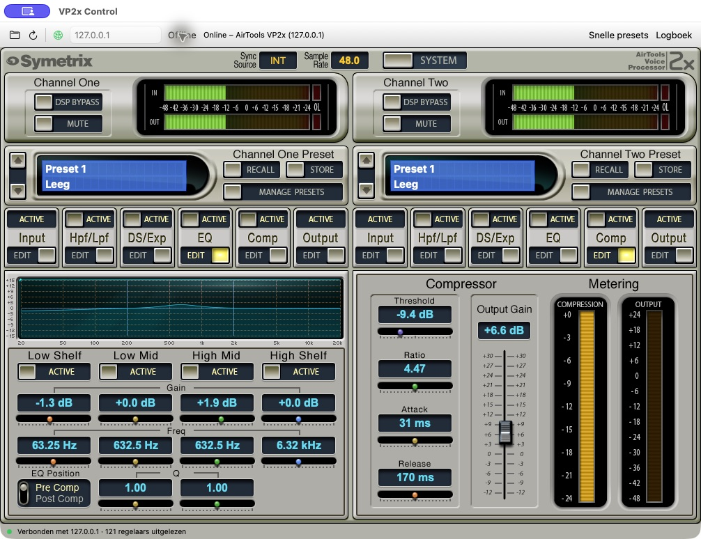

# Symetrix AirTools Voice Processor 2x voor MAC

Onafhankelijke native macOS-app voor de **Symetrix AirTools Voice Processor 2x**.
Bedient de bestaande hardware via Ethernet, zonder Windows of Parallels. De
audiobewerking blijft in de VP2x. Huidige versie: **0.3.11**.



*Voorbeeldscherm met gesimuleerde instellingen en lege presetlocaties.*

## Functies

- Beide kanalen met input/outputmeters, mute en DSP bypass.
- Input, HPF/LPF, de-esser/expander, compressor, vierbands-EQ en output.
- Klassieke tweekanaalsinterface, gebaseerd op de oorspronkelijke bediening.
- Live schuifbediening, invoer van numerieke waarden en fijne stappen via
  pijltjestoetsen of scrollwiel. Houd Shift ingedrukt voor extra fijne stappen.
- Presetbeheer op Mac of VP2x: laden, opslaan, kopiëren, hernoemen en wissen.
- Import/export van presets en snapshots; import van `.vp2x`/`.site`-projecten.
- Klein los venster met vier instelbare snelknoppen voor één of beide kanalen.
- Klokinstellingen, testtonen, AES-routing en netwerklogboek.

Firmware-updates zijn niet geïmplementeerd. De responscurves zijn berekend uit
instellingen, geen gemeten audiorespons.

## Downloaden

Download het [ZIP-pakket voor Apple Silicon, versie 0.3.11](https://github.com/pa3eke/Symetrix-AirTools-Voice-Processor-2x-voor-MAC/releases/tag/v0.3.11).
Pak het uit en sleep `VP2x Control.app` naar Programma’s. Vereist macOS 14 of nieuwer.

Het openbare pakket bevat geen gebruikerspresets of back-ups. De vaste
FTP-fabrieksconfiguratie uit de oorspronkelijke Windows-app is meegeleverd,
zodat ook het apparaatpresetbeheer zonder eigen build beschikbaar is.
De app is ad-hoc ondertekend en niet door Apple genotariseerd; macOS kan
het openen daarom blokkeren.

## Bouwen

Vereist macOS 14 of nieuwer en de Apple Swift-toolchain (Xcode Command Line Tools).
Geen externe pakketafhankelijkheden. Getest op Apple Silicon. De build gebruikt
de architectuur van de Mac waarop wordt gebouwd.

```sh
./script/build_and_run.sh --test
./script/build_and_run.sh --build-only
```

De app en het ZIP-bestand staan daarna in `dist/`. Kopieer `VP2x Control.app` naar
Programma’s en open de app. Vul het eigen IP-adres van je VP2x in en klik Online.
Mac en VP2x moeten elkaar via het lokale netwerk kunnen bereiken.

De app leest bij verbinden eerst de instellingen uit. Wijzigingen worden naar
het apparaat gestuurd en teruggelezen. De lokaal gebouwde app is ad-hoc
ondertekend en niet door Apple genotariseerd.

## FTP-configuratie voor apparaatpresets

De app gebruikt naast het besturingsprotocol FTP om het oorspronkelijke
projectbestand met presetnamen te lezen en bij te werken. De vaste
fabrieksconfiguratie uit de originele Windows-software is standaard opgenomen
in `DeviceFTPDefaults.json`. Dit zijn geen persoonlijke inloggegevens van een
gebruiker. De fabrieksconfiguratie is getest op één VP2x; compatibiliteit met
iedere firmwarevariant is niet bevestigd.

Een afwijkende configuratie kun je voor een eigen build lokaal toevoegen:

```sh
cp DeviceFTP.example.json Sources/VP2xCore/Resources/DeviceFTP.json
```

Vul dit bestand met de gegevens van jouw apparaat en bouw de app. Dit lokale
bestand krijgt voorrang op de fabrieksconfiguratie en wordt door Git genegeerd.
Publiceer geen eigen configuratie of daarmee gebouwde app met persoonlijke
inloggegevens.

## Eigen gegevens

Deze repository bevat **geen gebruikerspresets, snapshots, apparaatback-ups of
hardwarelogs**. Een nieuwe installatie krijgt geen vooraf ingevulde presetbank.
Lokale gegevens staan tijdens gebruik in:

`~/Library/Application Support/VP2x Control/Presets`

Een snapshot bevat actuele instellingen; een presetbank bevat opgeslagen presets.
Controleer de gekozen bron, bestemming, het kanaal en de locatie voordat je op het
apparaat opslaat. Maak vóór wijzigingen een eigen back-up.

## Herkomst

Dit is een onafhankelijk project, niet uitgegeven of ondersteund door Symetrix.
Het apparaatprotocol en de oorspronkelijke bediening vormden de basis voor de
implementatie. Zie [NOTICE.md](NOTICE.md) voor de grafische middelen en merken.
